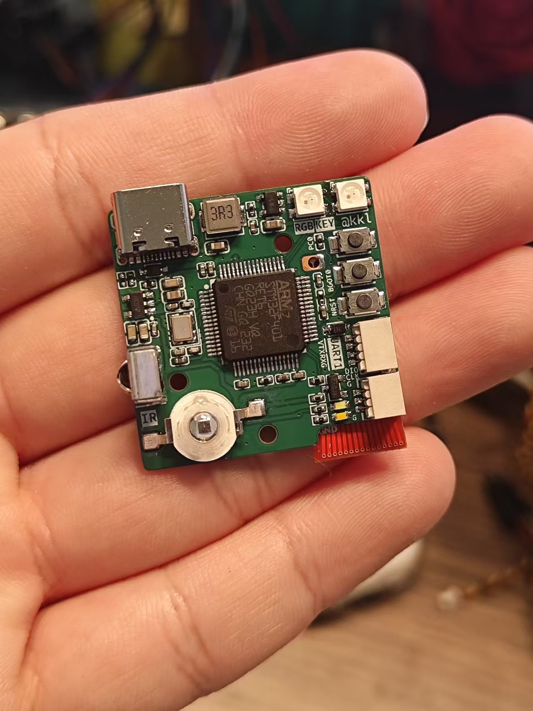
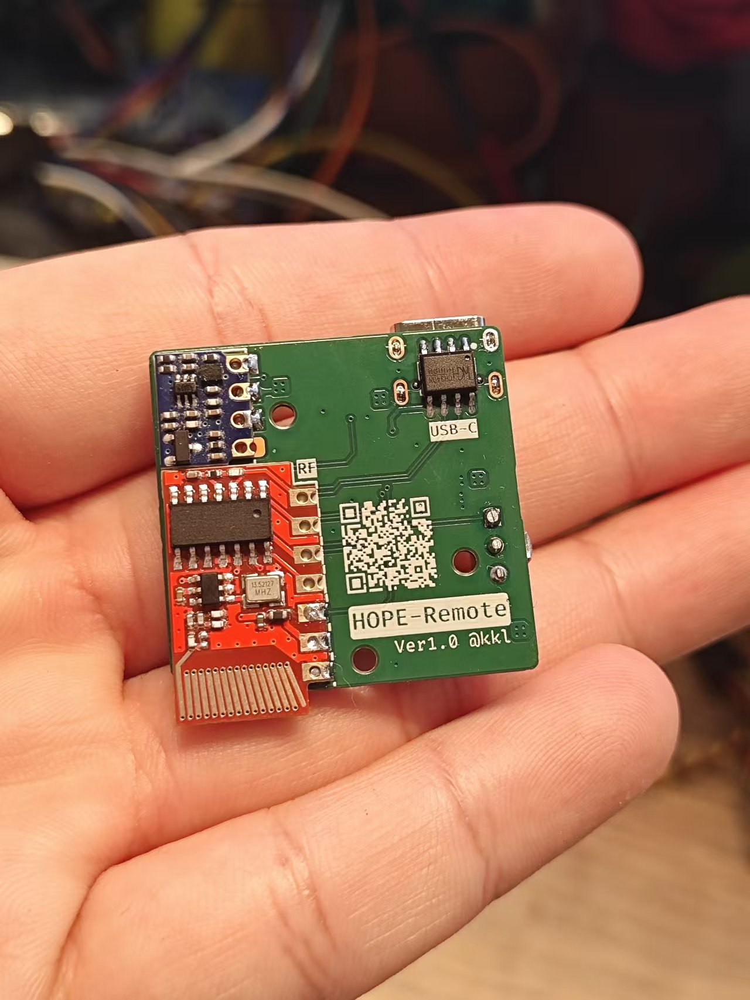

# HOPE-Remote

**红外 + 433 MHz 射频遥控码学习与回放器**


<p align="center">
  
  
</p>

把任意红外遥控器（38 kHz 载波）和 433 MHz 射频遥控器（EV1527）的按键「录」进 Flash 槽位，再用一条串口命令原样「放」出来。插上 Type-C 就能用，不需要上位机软件。

红外走的是**原始波形录制**，不做协议解码，因此不分品牌、不分协议；射频走**外接串口解码模块**，自动抓 24 bit 码值。

## 功能

| 能力 | 说明 |
|---|---|
| 红外学习 | 红外接收头（VS1838B / HS0038 类）+ ADC 边沿采样，录下整段原始波形（≤ 510 段），不依赖协议 |
| 红外回放 | PA1 软件翻转生成 38 kHz 载波，按段时长逐段重发 |
| 射频学习 | USART2 接 433 MHz 串口解码模块，连续 2 帧相同码即确认保存 |
| 射频回放 | PA5 直驱发射模块，帧数 / 簇数 / 帧间隔 / 簇间隔全可调 |
| 掉电保存 | 96 个红外波形槽 + 512 个射频码值槽，存内部 Flash |
| 状态指示 | 双 WS2812B 灯珠 + PC13 用户灯（学习期间常亮） |
| 全命令行操作 | USART1 @115200，学 / 放 / 查 / 删都由串口命令完成 |

## 快速开始

- **连接串口**

> [!NOTE]
> **115200 8N1，命令以 `\r` 或 `\n` 结尾。**

- **学习红外键**

```
xx000                 ← 串口输入，然后对着板子按遥控器，学习保存一个红外信号到槽位000
REC 0 start
REC 0 OK (68 seg, 67432 us, 1123ms)

fs000                 ← 回放槽位000的红外信号
FS 0 OK
```

> [!TIP]
> **Ps：槽位000 - 095都是红外信号的。**

- **学习射频键**

```
xx103                 ← 串口输入，然后对着板子按遥控器，学习保存一个射频信号到槽位103
REC 103 start
hold remote button until REC OK
REC 103 OK 0x62E7E8 pulse=320

fs103                 ← 回放槽位103的射频信号（默认 8 帧 × 1 簇，帧间隔 5 ms
FS 103 OK (v0 1x8 g5/300)
```

> [!TIP]
> **Ps：槽位100 - 611都是射频信号的。**

## 命令速查

| 命令 | 作用 |
|---|---|
| `xxNNN` | 学习到槽 NNN（000-095 红外，100-611 射频） |
| `fsNNN [f b g bg]` | 回放槽 NNN，可选覆盖发射参数 |
| `slots` | 列出槽位占用情况 |
| `duNNN` | 查看槽内容（红外段数组 / 射频码值） |
| `clNNN` | 清除槽 |
| `scNNN<hex6\|hex8>` | 免学习，直接把 EV1527 码写进射频槽 |
| `ledRRGGBB` / `lednRRGGBB` | 设置两颗 / 第 n 颗 RGB 灯珠颜色 |
| `uled0` / `uled1` | 用户灯灭 / 亮（硬件自检） |
| `help` | 板端帮助 |

完整命令（含调试命令 `rfmon` / `rfloop` / `rfscan` / `evtest` / `dbg` / `raw`）见 [docs/cli-reference.md](docs/cli-reference.md)。

## 仓库结构

```
HOPE-Remote/
├─ firmware/          STM32F401 固件（Keil MDK）
│  ├─ UserApp/        应用层：CLI、收发器、槽位存储
│  ├─ Bsp/            板级驱动：USART、WS2812B、用户灯
│  ├─ Core/           CubeMX 生成的 HAL 初始化与中断
│  ├─ Drivers/        CMSIS + STM32F4xx HAL
│  ├─ MDK-ARM/        Keil 工程与构建产物
│  └─ scripts/        编译 / 烧录 / 串口自测脚本
├─ hardware/          立创EDA 工程 + Gerber（v1.2）
├─ release/           预编译固件（直接烧录）
├─ images/            板卡预览与配件图
└─ docs/              设计与调试文档
```

## 文档

| 文档 | 内容 |
|---|---|
| [release/README.md](release/README.md) | 预编译固件与烧录方法 |
| [firmware/README.md](firmware/README.md) | 固件构建、烧录、引脚映射、代码结构 |
| [hardware/README.md](hardware/README.md) | 板级规格、接口、设计文件、打样装配 |
| [docs/cli-reference.md](docs/cli-reference.md) | CLI 命令完整参考（语法 / 参数 / 返回 / 示例） |
| [docs/slot-store.md](docs/slot-store.md) | 槽位存储层设计：Flash 布局、覆盖写、扇区原理 |
| [docs/rf-uart2-debug.md](docs/rf-uart2-debug.md) | 433 MHz 串口模块调试与回放时序结论 |
| [docs/hardware-notes.md](docs/hardware-notes.md) | 供电树、BOM、打样与装配注意 |

## 硬件

设计文件（PCB工程 & Gerber）与关键购件清单见 [hardware/](hardware/README.md).

## 已知限制

- **红外槽容量**：单槽 2 KB ≈ 510 段，个别空调长码会超出（`BufferFull`），此时只能录前半段。
- **射频协议**：只做 EV1527 类 24 bit 定长码；滚动码（HCS301 等）无法复制。
- **回放阻塞**：发射为忙等实现，期间不响应新命令（串口中断仍在收字节）。
- **单 Bank 擦写**：写 / 擦 Flash 时 CPU 取指停顿，属于设计前提，学习命令期间不执行实时任务。

## 许可

本项目采用 [MIT License](LICENSE) 发布，Copyright (c) 2026 hugokkl。

可自由使用、修改、分发与商用，保留版权声明与许可声明即可。固件与硬件设计文件同受此许可约束。
