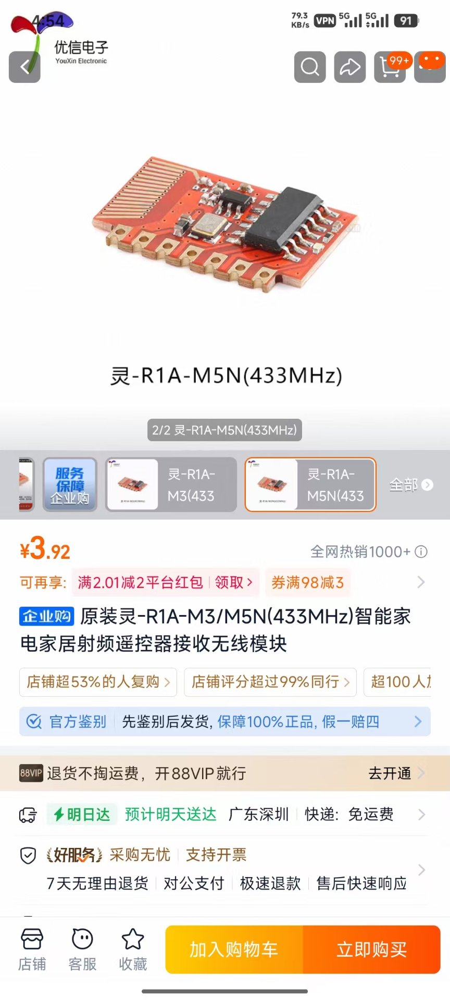
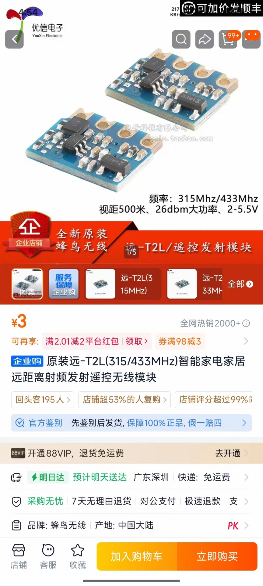
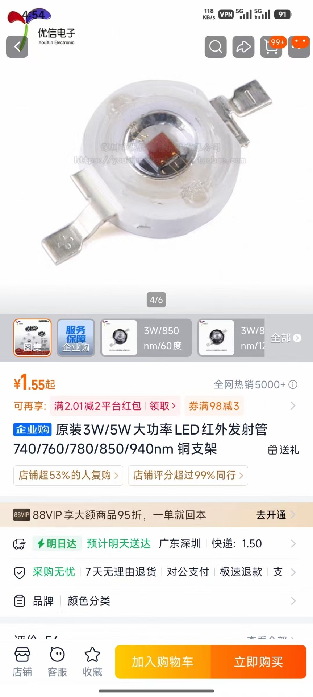

# HOPE-Remote Hardware

## 1. 板级概览

```
Type-C ─┬─ VBUS ─┬─ 5 V 升压（PW5100-50）─→ 红外发射管 / 射频模块 / WS2812B
        │        └─ 3.3 V LDO ───────────→ MCU / CH340N / 红外接收头
        └─ D+/D- ─→ CH340N ─→ USART1 (PA9 / PA10)

PA0  ← 红外接收头（VS1838B）        PA1  → 红外发射管（38 kHz 载波）
PA3  ← 射频接收模块（灵-R1A）       PA5  → 射频发射模块（远-T2L）
PA6  → 2 × WS2812B                 PC13 → 用户指示灯
```

## 2. 设计文件

| 文件 | 用途 |
|---|---|
| `ProPrj_HOPE-Remote_2026-11-26.epro2` | 立创EDA 工程 |
| `HOPE-Remote-v1.2-kkl_Gerber_PCB_2026-11-26.zip` | 打样文件 |


## 3. 打样

推荐板厚1mm，无阻抗要求。

## 4. 关键配件

红外与射频的收发均为外购件，实物参考（购件前对照确认型号）：

<p align="center">
  
  
</p>
<p align="center">
  
  
</p>

| 用途 | 型号 | 接线 |
|---|---|---|
| 红外接收 | VS1838B（38 kHz 一体化接收头） | OUT → PA0 |
| 红外发射 | 940 nm 3 W 发射管 | PA1 经 AO3400A 驱动 |
| 射频接收 | 灵-R1A-M5N-433MHz（**串口版**） | TX → PA3 |
| 射频发射 | 远-T2L-433MHz | DATA ← PA5 |

> [!WARNING]
> **射频接收器必须买「灵-R1A-M5N-433MHz 串口版」**
>
> 该系列有多个版本，只有串口版会通过串口（9600 8N1）主动输出 `LC:xxxxxx` 文本帧。不带串口的版本只输出电平 / 解码信号，本板 PA3 收不到任何数据，学习功能会一直 `TIMEOUT`。
>
> 下单前确认商品页标注「串口输出」「TTL 串口」或「UART」，认准型号里的 **M5N** 与 **433MHz**。

